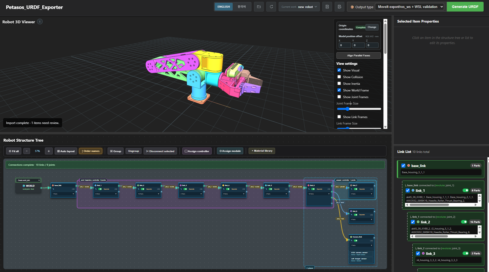

# Petasos URDF Exporter

[English](README.md) | [한국어](README.ko.md)



[사용법 영상 보기](https://youtu.be/H9movJFO4Fs)

**CAD 조립품을 편집 가능한 로봇 모델과 ROS 2 패키지로 만듭니다.**

Petasos는 로컬 브라우저에서 CAD 조립품을 불러오고, 로봇의 링크·조인트를 구성하며,
움직임을 확인한 뒤 URDF/Xacro description 패키지로 내보내는 편집기입니다.
최신 A4 개발 버전에는 재사용 로봇 모듈, 링크별 센서 장착 프레임,
익스포트 전 물성·충돌 검사도 추가되어 있습니다.

## 설명 대상 버전

이 README는 2026년 10월 7일 GitHub `main`에 게시한 A4 개발 버전을 설명합니다.
아래에 설명한 A4 기능은 이 저장소에 포함되어 있습니다.

## CAD 가져오기와 로봇 편집

- Inventor에서 열린 조립품에 직접 연결하거나 원본 IAM 경로를 선택하여 참조 IPT를 불러옵니다.
- STEP/STP, BREP, IGES/IGS, STL 또는 `*.petasos.json` 조립품을 가져옵니다.
- 3D 뷰어에서 부품을 선택하고 링크로 그룹화한 뒤 구조 트리에서 부모·자식 링크를 연결합니다.
- 바닥면, 월드 원점, 조인트 종류·축·제한값·동역학을 설정합니다.
- 이름별 편집 작업을 저장하고 복원합니다.
- 수정된 CAD를 다시 가져올 때 매칭된 링크 그룹·이름·조인트·바닥면 설정을 유지하고
  형상과 부품 위치를 갱신합니다. 부품 추가·삭제로 전체 매칭이 불가능하면 자동 적용을 중단합니다.

다른 CAD의 전용 조립품 형식은 조립 구조를 유지한 STEP으로 내보낸 뒤 가져오는 방식을 권장합니다.

## 최신 A4 개발 기능

### 3D 정렬과 동작 편집

- 서로 다른 링크의 면을 같은 방향 또는 마주 보는 방향으로 평행 정렬합니다.
- 부모·자식 연결면을 맞물리도록 자식 링크 그룹을 재배치합니다.
- 조인트 축과 영점을 조정하고 영점 변경을 취소할 수 있습니다.
- 물리적인 동작 축을 유지하면서 조인트 좌표계를 월드 축 방향에 가깝게 정렬합니다.
- 회전·연속 회전·직선 이동을 미리 보고, 부품이나 링크만 따로 표시해 확인합니다.
- 편집기에서 영어·한국어 인터페이스를 전환합니다.

### Mimic 관절과 컨트롤러

구동 관절과 이를 따라가는 관절을 지정하고 배율·오프셋을 설정하여 연동 동작을 미리 봅니다.

```text
종속 관절 위치 = 배율 × 구동 관절 위치 + 오프셋
```

음수 배율과 0이 아닌 오프셋도 동작 미리보기에 반영됩니다. 익스포트에서는 mimic 관계와
컨트롤러 구성을 검사하여 종속 관절을 독립 구동 관절처럼 명령하지 않도록 합니다.
ROS 2 Humble용 궤적·그리퍼 제어 구성을 지원하며, Humble의 `GripperActionController`는
단일 구동 관절과 position·velocity 상태 인터페이스가 필요합니다.
Mimic 종속 관절은 구동 관절에 종속된 상태로 유지됩니다.

### 재질과 물성 편집

검색 가능한 재질 라이브러리에서 부품에 재질을 지정하거나, 재질 카드를 링크에
드래그하여 그룹 전체에 적용합니다. 이름·밀도·색상을 지정한 사용자 재질을 추가하거나
CAD 원본 재질을 유지할 수 있습니다.

체적 또는 기준 물성 데이터가 있으면 밀도 지정에 따라 물성을 갱신하고 예상 질량을 표시합니다.
필요한 데이터가 없는 부품은 별도 확인이 필요합니다. A4 익스포터는 원본 가져오기
메타데이터가 남아 있는 경우 기존 Inventor 질량중심 데이터도 복구합니다.

### 재사용 로봇 모듈

Ctrl+클릭이나 영역 선택으로 링크와 내부 조인트를 직접 선택해 모듈로 지정하고
로컬 라이브러리에 저장합니다. 고유 Prefix를 붙여 다른 부모 링크에 장착하거나,
기존 장착 조인트의 설정·변환을 유지하면서 다른 모듈로 교체할 수 있습니다.

- 장착 XYZ/RPY를 편집하여 모듈 전체를 이동합니다.
- ZIP 내보내기·가져오기로 라이브러리 항목을 옮깁니다.
- 서버 세션 안에서 장착·교체·장착 좌표 변경을 실행 취소합니다.
- 모듈 내부 구조를 별도 Xacro 파일로 내보내고 본체 Xacro에서 포함합니다.
- 모듈 링크에 속한 센서 프레임도 라이브러리·익스포트 작업에 함께 포함합니다.

첫 구현은 단일 장착 조인트를 가진 연결된 끝단 구조를 지원합니다.
루트 모듈, 이동 베이스, 중첩 모듈은 지원하지 않습니다. 교체 시 새 도구의 TCP까지
자동 정렬하지는 않습니다. ROS를 종료한 뒤 모듈 교체 → 재익스포트 →
MoveIt 설정 재검토 → 재실행 순서로 진행합니다.

### 링크별 센서 장착 프레임

링크에 Depth Camera, RGB Camera, LiDAR, IMU, Generic 센서를 추가합니다.
XYZ는 mm, RPY는 도 단위로 입력하거나 3D 표면을 클릭해 위치를 지정합니다.
선택한 센서 좌표축을 확인하고, 다른 링크로 옮길 때 월드 장착 위치·방향을 유지할 수 있습니다.

센서마다 메시·질량이 없는 `<이름>_frame` 링크와 고정 조인트가 출력됩니다.
센서 정보는 프로젝트에 저장되며 재사용 모듈에도 포함됩니다.

이 기능은 **URDF/TF 장착 좌표계**를 생성합니다. Gazebo 센서 플러그인, 영상·
포인트클라우드·IMU 토픽, 실제 센서 드라이버는 별도 설정이 필요합니다.

### 익스포트 전 물성·충돌 검사

최종 출력물을 교체하기 전에 후보 패키지를 준비하고 진단 결과를 표시합니다.

| 검사 | 표시 내용 |
|---|---|
| 질량 | 유한하지 않거나 0 이하인 값 |
| 질량중심 | 링크의 시각 메시 경계 밖에 있는 값 |
| 관성 | 잘못되었거나 양의 정부호가 아닌 관성 텐서 |
| 물성 출처 | 신뢰도 확인이 필요한 STL·대체 계산값 |
| 충돌 형상 | 메시 단순화 비율과 시작 자세에서의 메시 접촉 |
| 충돌 검사 도구 | 정밀 검사를 수행하지 못한 겹침 후보 |

물성 오류가 있으면 최종 반영을 막습니다. 경고·미검사 항목은 확인 후 진행해야 합니다.
준비 또는 검사에 실패하면 이전에 성공한 출력물을 보존합니다.
성공한 출력의 description 패키지에는 `analysis/export_preflight.json` 진단 보고서가 저장됩니다.

충돌 메시를 단순화한 뒤 실제 STL의 폐곡면·면 방향·크기·부피·연결된 덩어리 수를 검사합니다.
검사를 통과하지 못하면 원본 충돌 메시를 사용합니다. 원본 자체의 구멍·중복 면은
자동으로 숨기거나 메우지 않고 진단표에 계속 표시합니다.

MoveIt을 다시 내보내면 현재 컨트롤러·모듈 그룹·조인트 제한·제로/홈 자세를 반영합니다.
계속 유효한 사용자 튜닝과 충돌 제외 설정은 유지하고, 이전 설정 전체는
`ros_ws/.petasos-previous/`에 백업합니다. 자동 유지하지 못한 설정은 검토 경고로 표시하며,
변경 목록은 `ros_ws/moveit_settings_diff.json`에 저장합니다.

정밀 메시 충돌 검사는 `python-fcl`을 사용할 수 있을 때 수행합니다.
도구가 없으면 겹침 후보를 **미검사**로 표시합니다. 검사는 설정된 시작 자세를 대상으로 하며,
로봇의 전체 동작 범위에서 충돌이 없음을 보장하지 않습니다.

## ROS 2·RViz·MoveIt 작업 흐름

RViz용 ROS 2 Humble description 패키지를 만들거나,
MoveIt 작업공간 출력을 선택해 설정 패키지를 함께 생성합니다. WSL2에서 다음 흐름을 지원합니다.

1. 출력 모델을 RViz에 동기화하고 실행합니다.
2. MoveIt Setup Assistant에서 planning group, controller, self-collision matrix를 구성합니다.
3. 생성 설정을 검사하고 필요한 YAML 숫자 형식을 정규화한 뒤 빌드·데모를 실행합니다.
4. 자동 계획·데모 컨트롤러 동작 검사를 실행합니다.

모듈 교체나 로봇 구조 변경 후에는 MoveIt 설정을 다시 확인해야 합니다.
데모 흐름에 실제 로봇의 하드웨어 드라이버 설정은 포함되지 않습니다.

## 시작하기

주요 로컬 실행 흐름은 Windows 실행 파일을 사용합니다.
처음 사용하는 컴퓨터에서는 프로젝트 폴더를 완전히 압축 해제한 뒤 다음 파일을 실행합니다.

```text
setup_petasos.cmd
```

설치 도우미는 Python·프로젝트 환경, Inventor 연결,
RViz·MoveIt용 WSL2 / Ubuntu 22.04 / ROS 2 Humble 도구를 검사합니다.
설치 단계에 사용자 확인이나 재부팅이 필요할 수 있습니다.

설정 후 편집기를 실행합니다.

```text
start_petasos.cmd
```

브라우저가 자동으로 열리지 않으면 `http://127.0.0.1:5050/`에 접속합니다.
명령 창을 닫으면 로컬 서버도 종료됩니다.

## 기본 작업 순서

1. 조립품을 불러오거나 저장한 작업을 복원합니다.
2. 모델 방향·바닥면·월드 원점을 지정합니다.
3. 부품을 링크로 그룹화하고 조인트를 연결합니다.
4. 축·제한값·동역학·동작을 설정합니다.
5. A4에서는 필요에 따라 재질·mimic 관계·재사용 모듈·센서 프레임을 추가합니다.
6. 출력 유형을 선택해 패키지를 생성하고, A4에서는 사전 진단 결과를 확인합니다.
7. RViz에서 결과를 확인하고 선택적으로 MoveIt 설정·검사를 진행합니다.

## 출력과 로컬 저장 위치

| 위치 | 내용 |
|---|---|
| `export/ros_ws/src/` | 작업공간 출력 선택 시 ROS 2 패키지 |
| description 패키지의 `urdf/`·`meshes/` | 로봇 URDF/Xacro와 메시 |
| description 패키지의 `urdf/modules/` | A4의 모듈별 Xacro |
| description 패키지의 `analysis/` | 출력 진단·분석 결과 |
| `standalone_projects/` | 로컬 저장 프로젝트 |
| `standalone_modules/` | A4의 로컬 재사용 모듈 라이브러리 |

로컬 프로젝트·모듈 라이브러리·생성 출력 폴더는 Git에 포함되지 않습니다.

## 프로젝트 구성

- `URDF_Exporter/standalone`: 로컬 서버, CAD 가져오기, 프로젝트 저장, 익스포트
- `URDF_Exporter/core`: 로봇 구조, 익스포터 코드, 편집기 인터페이스
- `moveit`: MoveIt 설정 검사와 WSL 실행 도우미
- `tools`: Windows·WSL2·ROS 2 설치 도우미
- `tests`: 자동 회귀 테스트
- `examples`·`schemas`: 조립 교환 형식 예제와 스키마

## 원본 프로젝트 고지와 라이선스

일부 Fusion 360 내보내기 코드는 Toshinori Kitamura의
[syuntoku14/fusion2urdf](https://github.com/syuntoku14/fusion2urdf)를 기반으로 수정되었으며,
원본 코드는 MIT License로 배포됩니다.

Petasos에서 새로 작성되거나 확장된 부분의 저작권은 Petasos contributors에게 있습니다.
자세한 조건은 [LICENSE](LICENSE)를 확인하세요.
