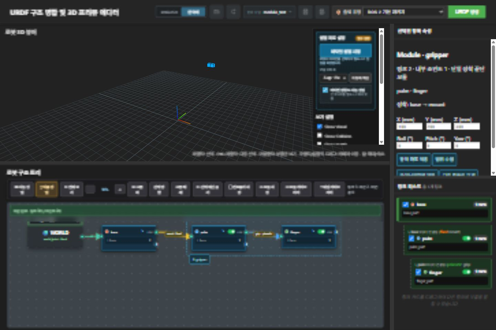

# Reusable robot modules — verification, 2026-09-28

Implemented on `codex/reusable-robot-modules`, based on local `main` at 0829f07. Not merged or pushed.

## Results

- Python: `python -m unittest discover -s tests -q` — 146 passed.
- JavaScript selection: `node --test tests/test_module_selection.cjs` — 2 passed.
- `git diff --check` — passed (Windows line-ending notices only).
- Actual Xacro expansion tested, including two instances, final joint names, meshes, and ros2_control references.
- Disposable local UI fixture: Ctrl-click links/internal joint, create/name module, open properties, save library, preview/attach, Ctrl+Z restore, range edit, rectangle selection after zoom/pan, Escape cancel. Browser console had no errors.
- The fixture server was stopped and the temporary browser viewport reset. User project data was not used for UI testing.
- WSL enumeration returned access denied; live RViz, Gazebo, and MoveIt Plan/Execute are NOT verified.

## Final review

One independent reviewer found three Important issues. Regression tests first failed, then passed after one fix pass:

1. Material/controller collisions now reject before merging. Identical shared material values may be reused during replacement.
2. Undo captures the submitted pre-action tree, preserving preceding unsaved edits.
3. Retained, byte-identical meshes can be reused after undo or same-prefix replacement. Partial new mesh copies are removed on failure. Different existing geometry is never overwritten: use a new prefix for a different mesh.

Deferred minor: replacement preview currently shows name/count, not the full old/new membership and renamed-reference comparison.

## Decisions and limitations

- Native worktree tooling could not target the nested repository; used a manual local worktree. Cost: not managed by the app's worktree tooling.
- The POSIX task helper failed on Windows path handling; used manual bookkeeping. Cost: manual progress tracking. Parent helper stopped; child termination was denied by the OS.
- Dedicated module API/UI files keep the feature isolated. Cost: additional static routes, also added to the legacy server.
- Attach/restore reloads the viewer and retains history through sessionStorage. Cost: brief page reload; undo remains session-scoped.
- GripperActionController requires position and velocity state feedback; invalid configurations fail explicitly. Cost: user must enable velocity for that controller; position-only JTC remains supported.
- Installed xacro/PyYAML in the existing venv for real expansion testing. Cost: two test dependencies.
- Existing differently shaped assets require a new prefix rather than overwrite. Cost: retained undo assets consume disk and changed replacements need a new prefix.
- Live ROS behavior remains unverified due to WSL access denial. Cost: runtime integration may need further fixes.
- GUI testing covers the representative local fixture, not every screen size or model. Cost: broader UI edge cases may remain.
- Archive path/size/symlink checks are tested, not exhaustively fuzzed. Cost: malformed-input edge cases may remain.
- Non-default preview units were not established as a supported representative fixture. Cost: unusual-unit projects need additional validation.
- Cosmetic changes and broad refactoring were excluded. Cost: existing appearance/architecture remains.

Version 1 supports manually selected terminal modules with one incoming attachment. It does not automatically include descendants, merge links, or support nested/mobile-base modules. The branch is preserved for integration choice.

